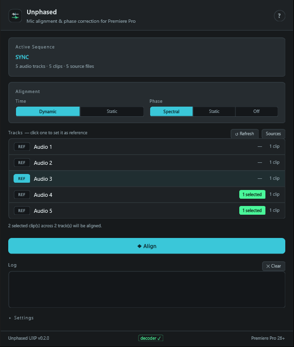

# Unphased

[](https://github.com/thinkvp/Unphased/actions/workflows/engine-ci.yml)
[](https://github.com/thinkvp/Unphased/actions/workflows/uxp-ci.yml)
[](LICENSE)

An Auto Align Post-style audio alignment plugin for Adobe Premiere Pro: align lav
mics (and any other mics) to a reference track (boom) with **dynamic time-varying
delay correction**, **automatic polarity fixing**, and **spectral phase
correction**, then place rendered, aligned audio back into the timeline
non-destructively.



*The panel. Audio 3 is the reference; the two tracks with selected clips
become targets automatically, and the line under the list says exactly what
Align will do.*

## Requirements

| | |
|---|---|
| **Premiere Pro** | 26.0 or newer |
| **OS** | Windows x64, macOS (Apple Silicon or Intel) † |
| **ffmpeg** | Bundled — no install needed |
| **Node.js** | Not needed |
| **Install** | Download the `.ccx`, double-click |

Premiere 26.0 is a hard floor: Unphased bundles its FFmpeg decoder as a UXP
*hybrid* addon, and 25.x loads the panel and then reports "Addon is not
supported".

† **macOS is built and tested, but not yet confirmed in Premiere.** The `.ccx`
carries a universal (Apple Silicon + Intel) decode addon, and CI builds it from
source and verifies it decodes bit-exactly against the test fixtures on every
change. What no automated check can cover is the panel actually running in
Premiere on a Mac — nobody has done that yet. Treat the macOS build as a beta
and report what you find. macOS will also block the plugin on first load — see
[macOS: expect a security warning](#macos-expect-a-security-warning-the-first-time).

## Install

No admin rights and no Developer Mode toggle — Adobe allows independent `.ccx`
plugins to install directly. **On macOS there is one extra step**, because the
bundled decoder is not signed with an Apple Developer ID; see below.

1. Download `Unphased-UXP-<version>.ccx` from the
   [Releases page](https://github.com/thinkvp/Unphased/releases).
2. Double-click it. Creative Cloud Desktop opens an **"Install a non-marketplace
   plugin"** dialog — click **Install**.
3. On Windows you may be prompted for your account credentials as part of
   installing the addon (it needs filesystem access to read your media) — that is
   a normal elevation prompt, not a malware warning.
4. Open (or restart) Premiere Pro and find the panel under
   **Window → UXP Plugins → Unphased**.

The whole package is ~1.3 MB: the panel, plus a trimmed, statically linked
audio-only FFmpeg 8.1.2 as a native hybrid addon. Nothing goes on PATH and
nothing else is downloaded.

### macOS: expect a security warning the first time

The bundled decoder is a native binary that is **not signed with an Apple
Developer ID**, so macOS blocks it on first load. This is expected, and the
plugin will not work until you clear it:

1. Install the `.ccx` as above, then open Premiere Pro. It will say it **can't
   load the plugin**.
2. Go to **System Settings → Privacy & Security** and scroll down. There will be
   a message about **Unphased** being blocked — click **Allow Anyway**.
3. **Restart Premiere Pro.** The panel should now load.

If the decoder is still blocked, the panel says so and repeats these steps.

The only way to remove that warning is a **$99/year Apple Developer account** to
sign and notarise the binary. I don't use a Mac and this is a free plugin, so
that isn't something I'm planning to pay for. The build is reproducible and the
addon is compiled from source by CI on every release — see
[`.github/workflows/release.yml`](.github/workflows/release.yml) and
[`uxp/native/README.md`](uxp/native/README.md) if you would rather check what is
in it than take my word for it.

## Layout

```
engine/     standalone Node.js DSP engine (zero dependencies) — the brain
uxp/        the Premiere plugin (UI + UXP host layer + native decoder)
docs/       architecture notes
testmedia/  generated test fixtures with known ground truth
.github/    CI workflows, issue and PR templates
```

`engine/` is the single source of truth for the alignment maths. The plugin runs
a CommonJS transpile of the same files in-panel (`uxp/scripts/build-engine.js`,
with `npm run lint` failing on drift), and `engine/cli.js` runs them directly
for headless use and for the end-to-end tests.

## Aligning

1. Open a sequence. The panel reads it and probes each media file's audio layout
   automatically — there is no Scan step.
2. Click one track to mark it **REF** (the boom, or whichever mic is the
   yardstick).
3. **Select the clips you want aligned** in the timeline. Any other track with a
   selected clip becomes a target, live, as you click around — the badge beside
   each track shows its current selected count. Select everything on a track to
   process the whole thing.
4. If the log flags multiple mics per file, press **Sources** and check the
   source-channel assignment. The pickers are hidden otherwise.
5. Options, two of them: **Time** (Dynamic tracks drift, Static applies one
   offset) and **Phase** (Spectral tracks a changing phase relationship, Static
   fits one curve to the whole clip, Off leaves the target's own character
   alone).
6. Press **Align**. Per clip, the engine extracts the overlapping audio, aligns
   it, and renders a new WAV. The panel imports the results into an **Unphased**
   bin, places them on new tracks at the exact original positions, and disables
   the originals.

The reference track is never filtered by selection — it is the yardstick, and
supplies material wherever it overlaps a target. **Refresh** (next to Sources)
re-reads the sequence; you only need it after adding a track, adding clips, or
swapping media without switching sequences, since Align re-reads for itself
first.

Failed pairs (no correlation, too little overlap, offline media, speed-changed
clips) are skipped with a warning; nothing in your timeline is modified for those.

A target clip spanning several reference clips is aligned **segment by segment**,
one rendered file per reference clip, each placed at its own position. Originals
are muted **only when the aligned segments replace them end to end** — a
partially covered clip stays audible so no silent gap is created.

Stereo and multichannel clips keep their channel count, sample rate and bit
depth: the analysis runs on a 48 kHz mono signal, but the correction is applied
to every channel at the source's own rate.

The panel blocks Premiere's UI in short bursts while it works — there is no
child process to offload the DSP to. **Cancel** takes effect after the segment
in flight.

### Source channels — read this if you use camera audio

Premiere's scripting API does **not** expose which audio channel or stream a
timeline clip is using. A multi-input camera (Sony FX6
etc.) writes one mono stream per mic and Premiere lays them across consecutive
audio tracks, so several tracks share one media path and differ only by stream.

The panel probes each media file as it reads the sequence, and offers a
**source picker** on any
track whose file gives a choice (`src 1`, `src 2` … for multi-stream files;
`left`, `right`, `stereo` for interleaved stereo). The default assigns streams by
track order among tracks sharing a file, which matches how Premiere lays them
out.

The pickers are hidden by default — for ordinary single-mic files there is
nothing to decide. The **Sources** button above the track list shows them, and
only appears when some track's media actually offers a choice. When the
assignment is a real guess the log says so: **open Sources and verify
before aligning** — if two tracks point at the same stream, you are aligning a
signal with itself.

That case is caught: pairs whose reference and target resolve to the same file,
time *and* channel are refused with a warning rather than producing a meaningless
result.

### Where the rendered files go

The aligned WAVs are project media — Premiere references them for as long as the
project exists — so they are written to an **`Unphased Audio`** folder beside the
`.prproj`, and each run stamps its filenames with the date and time so
re-aligning never overwrites audio a clip already points at. Old runs can be
deleted once you are happy with the current one.

Override the location with **rendered audio folder** in Settings
(`unphased.renderDir`) — the only setting there is, since nothing external needs
pointing at. On a project that has never been saved there is nowhere to put the
files, so they fall back to the plugin's own data folder and the log says so —
save the project and align again to keep them.

### Reading the results

`Null` is the headline number: how deeply the aligned clip cancels against the
reference. It is measured over 2-second stretches, each at its own level, and
the typical stretch is reported — so a long take where people move around the
room is not marked down for level changes that have nothing to do with timing. Interpret it in context — it is not "higher is always better proof of
success":

- **> 40 dB** — suspiciously perfect. Almost always means both sides decoded the
  *same* audio. Check the source assignment.
- **10–25 dB** — a genuinely good alignment of two different mics on the same source.
- **3–10 dB** — normal for mics in very different positions (lav vs
  camera-mounted). The timing is corrected; the acoustics still differ, and no
  tool can null that away.
- **< 2 dB with `Pol ok`** — little real correlation; treat the result with suspicion.

A `Delay` of exactly ±0.0 ms with `Drift —` and a huge null is the signature of a
clip aligned against itself.

## Verifying with the test project

1. `node engine/cli.js gen-fixtures testmedia` (already generated).
2. New Premiere project → import `testmedia/boom.wav`, `lav1.wav`, `lav2.wav`.
3. Drop boom on A1, lav1 on A2, lav2 on A3 — all starting at 00:00.
4. Panel: click A1 to make it **REF**. Select the lav1 and lav2 clips in the
   timeline, leave Time on Dynamic → **Align**.
5. Expected (see `testmedia/ground-truth.json`):
   - lav1: delay ~ +18 ms with ~3 ms drift span, polarity **inv**, deep null.
   - lav2: delay ~ +7.3 ms, phase correction applied, deep null.
6. A/B: the originals are disabled; apply Invert on the boom clip and play an
   aligned track — it should nearly cancel.

## Tests

```bash
cd engine && npm test                # 83 tests — the DSP
cd uxp && npm run lint && npm test   # 42 tests — the plugin
```

Both suites are pure Node with no dependencies to install. CI runs them on every
push and pull request — see [`.github/workflows/`](.github/workflows/).

The engine suite covers WAV I/O, FFT, GCC-PHAT, static + dynamic alignment
against synthetic and real-resampler drift, polarity, static and time-varying
phase correction, coherence band weighting, quiet-recording robustness,
stereo/96 kHz preservation, the job protocol CLI (with ffmpeg), and the
pairing and channel-mapping logic. Tests
needing ffmpeg skip themselves when it is absent.

The plugin suite covers the generated CommonJS engine (exports and numbers
matching the ESM source), the decode/padding layer, an end-to-end run against
`testmedia/`, the panel's static wiring, and — when the native harness has been
built — the decode core's sample-accuracy and channel selection.

### What is and isn't verified

Offline coverage is good; the parts that need a running Premiere are the gap.

| Area | State |
| --- | --- |
| DSP (`engine/src/`, `uxp/js/engine/`) | Covered against fixtures with known ground truth; the generated copies are checked to match the ESM source |
| Native FFmpeg addon | Windows x64 committed and self-contained (imports only `bcrypt`/`user32`/`kernel32`); macOS universal built from source by CI. Decode verified bit-exact on both, incl. AAC frame-boundary trimming and per-channel selection |
| Decode layer (`uxp/js/audio.js`) | Padding, cancel checks and UI yields covered |
| Runner (`uxp/js/runner.js`) | End-to-end offline: mono, stereo preservation, failure handling |
| Panel UI | DOM wiring, control bindings and the packaging list checked statically |
| Host ops (`uxp/js/premiere.js`) | Written against the documented UXP API — **not yet exercised against a live Premiere 26 session** |
| macOS | Addon builds universal and passes the decode-core tests in CI; **the panel has never been run in Premiere on a Mac** |

## Contributing

Bug reports and pull requests are welcome — see [`CONTRIBUTING.md`](CONTRIBUTING.md)
for the layout rules that matter (the engine is the single source of truth, the
in-panel copies are generated) and what CI checks. Release history is in
[`CHANGELOG.md`](CHANGELOG.md).

## License

[MIT](LICENSE) for Unphased's own code. Bundled third-party components keep
their own licenses — see [`LICENSE`](LICENSE).

Bundling FFmpeg means complying with the **LGPL v2.1+**: the addon links an
LGPL-configured FFmpeg 8.1.2 (`--disable-everything` plus audio-only
components), with no GPL components enabled. Source: <https://ffmpeg.org>; see
[`uxp/native/README.md`](uxp/native/README.md) for how the addon is built. IBM
Plex fonts are under the OFL (`uxp/fonts/LICENSE.txt`).
